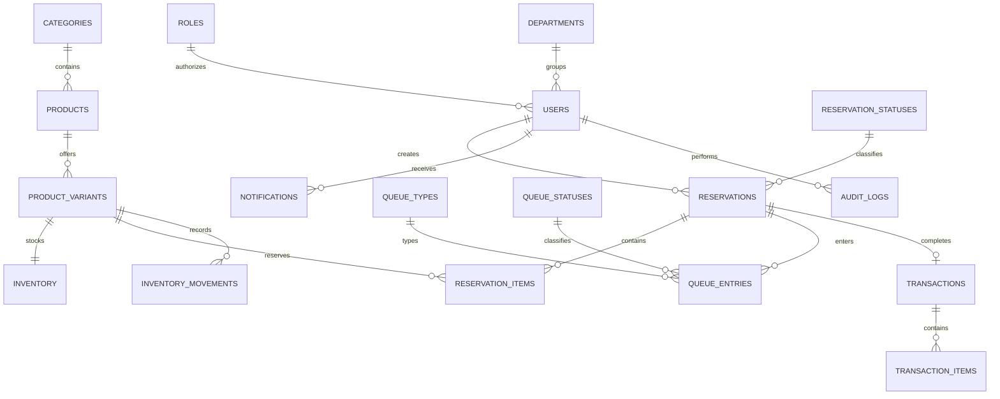

# Supabase Postgres database

Supabase Postgres is the normalized SQL operational database used for deployment. It is PostgreSQL, not Microsoft SQL Server. The validated SQL Server provider remains available for local compatibility; both providers use the backend repository and transaction services.

The browser security boundary is `Frontend -> Vercel API -> Supabase Postgres`. The browser has no operational table-write path, database password, or service-role key. Auth0 remains the identity provider: a verified Auth0 email maps to `dbo.users.email`; unknown and inactive users receive `403`, and the database role is authoritative.

Use Supabase's transaction-mode pooler URL for Vercel serverless functions, set it as `SUPABASE_DATABASE_URL`, set `POSTGRES_SSL=true`, and set `SUPABASE_CA_CERT_PATH=certs/supabase-prod-ca-2021.crt`. The checked-in public CA is the certificate downloaded from the project's Supabase Database Settings; the driver keeps certificate and hostname verification enabled. Run `npm run db:pg:schema`, `npm run db:pg:seed`, and `npm run db:pg:integrity`. Demo `.test` identities are data fixtures and cannot be used for live Auth0 login.

The 24 tables are defined and commented by purpose in [the executable schema](../database/postgres/001_normalized_schema.sql): reference tables, users, catalog, inventory, reservations, queues, sales, movements, notifications, audit, settings, idempotency, and outbox. Primary/foreign keys prevent orphans; unique constraints protect SKU, variant SKU, references, transactions, active queues, idempotency keys, and terminal outbox events; checks protect statuses, money, quantities, roles, and inventory invariants. Separate entities and junction/detail tables preserve third-normal-form relationships instead of duplicating user, product, status, or inventory facts.

Power Automate is automation only, not the primary database. Excel is reporting/export only, not the database. The outbox dispatcher uses PostgreSQL `FOR UPDATE SKIP LOCKED`; no real dispatch occurs in database tests.

No live data is migrated automatically. Export SQL Server tables in foreign-key order, transform dates to ISO-8601 and payloads to JSON, import reference/parent tables before children, then run `db:pg:integrity`. Keep the old database read-only until counts and workflow smoke tests agree.
