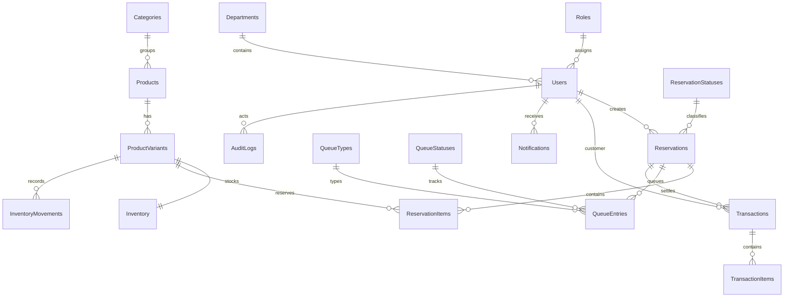

# SQL Server database

SQL Server is the operational source of truth. REST services use `SqlServerRepository`; Power Automate remains for notifications and scheduled automation. Graph and Power Automate repositories remain optional legacy adapters. SQL Server Developer Edition is for local development/testing only, not production hosting.

The schema is in practical third normal form: roles/statuses/types use reference tables; relationships use IDs; availability and line totals are derived; historical unit prices remain on line items. Cascading deletes are intentionally absent.

## Local configuration and scripts

Copy `.env.example` to ignored `.env.local` and set `SQL_SERVER`, `SQL_PORT`, `SQL_DATABASE`, `SQL_USER`, and `SQL_PASSWORD`. TLS options are `SQL_ENCRYPT` and `SQL_TRUST_SERVER_CERTIFICATE`.

- `npm run db:check` — connection and safe server/database metadata
- `npm run db:schema` — idempotent schema
- `npm run db:seed:reference` — idempotent reference data
- `npm run db:seed:demo` — optional demo records, no passwords
- `npm run db:workflows` — additive idempotency, outbox, and workflow constraints
- `npm run db:verify` — tables, constraints, reference counts, derived availability
- `npm run db:smoke` — live read checks for catalog, inventory, and settings

After schema creation, the developer may remove `db_ddladmin` from `bulldogs_app`; runtime access should have only required read/write permissions.

## Future SharePoint import mapping

`Categories → Categories`, `Products → Products`, `Product Variants → ProductVariants`, `Inventory → Inventory`, `Users → Users`, `Reservations → Reservations`, `Reservation Items → ReservationItems`, `Queues → QueueEntries`, `Transactions → Transactions`, `Transaction Items → TransactionItems`, `Inventory Movements → InventoryMovements`, `Notifications → Notifications`, `Audit Logs → AuditLogs`, `System Settings → SystemSettings`.

Possible future import sources are CSV, Excel, or a Power Automate read flow. No migration or dual-write runs automatically.

Inventory movement `PreviousQty`, `ChangeQty`, and `ResultingQty` describe physical quantity. `PreviousReservedQuantity` and `ResultingReservedQuantity` record reservation changes explicitly; reserve/release movements therefore have physical `ChangeQty = 0`.
